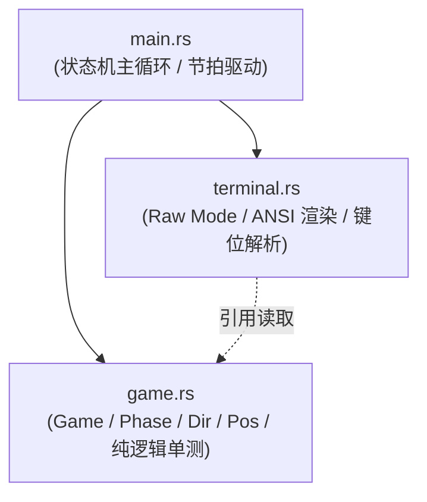

# 02 架构设计与类型建模

良好的软件设计应当让代码结构自然对应业务模型。在 Rust 中，类型系统是架构设计的核心驱动力，核心目标是**使非法状态在编译期就无法表达**。

## 分层架构设计

项目采用严格的单向依赖分层体系，将易变的外部终端环境与稳定的领域规则清晰隔开：



### 各层职责规范

- **应用编排层（`src/main.rs`）**：
  - 维护主事件循环。
  - 依据游戏得分计算当前时钟节拍。
  - 根据当前阶段（`Phase`）驱动输入捕获与步进调度。
- **纯领域逻辑层（`src/game.rs`）**：
  - 承载游戏世界的所有实体状态（蛇身坐标队列、行进方向、食物位置、当前阶段与得分）。
  - 实现方向转向校验（`turn`）、世界步进一步（`step`）以及无偏食物采样（`place_food`）。
  - **完全不引入任何终端与 I/O 依赖**，可在无终端环境下运行自动化测试。
- **终端适配层（`src/terminal.rs`）**：
  - 封装 Raw Mode 与交替屏幕的生命周期守卫（`RawMode`）。
  - 提供非阻塞输入事件轮询（`read_input`）。
  - 聚合 ANSI 屏幕指令并执行高效单次刷盘（`draw`）。

## 类型驱动设计（Type-Driven Design）

下表展示了本项目在 Rust 中的类型选型，及其相比 C 与 Python 的本质跃迁：

| 领域概念 | Rust 选型 | C 语言常见做法 | Python 常见做法 | Rust 类型系统的保证 |
|---|---|---|---|---|
| 行进方向 | `enum Dir { Up, Down, Left, Right }` | `#define UP 0` 整数常量 | `Enum` 类或 `'up'` 字符串 | 编译期强制覆盖所有方向，杜绝无效值 |
| 阶段状态 | `enum Phase { Ready, Playing, Over }` | `int started, over;` 多个标志 | `self.started`, `self.over` 布尔值 | 非法状态组合在类型空间中根本不存在 |
| 按键输入 | `enum Input { Move(Dir), Quit, Retry }` | 函数返回整型错误码或约定的数字 | 返回元组或字面量字典 | 变体可携带强类型数据，分支遗漏编译报错 |
| 可选状态 | `Option<Input>` | 特殊魔数（如 `-1`）或空指针 | 返回 `None` 依靠调用者自觉 | 显式标记可能缺失，强制调用方处理空值分支 |
| 坐标表示 | `struct Pos { x: u16, y: u16 }` | 结构体配合 `int` | `tuple[int, int]` | 无符号数消除负值隐患，配合溢出饱和算术防越界 |
| 资源生命周期 | `struct RawMode` 实现 `Drop` | 手动在每个退出点成对释放 | `curses.wrapper` 上下文管理 | 基于 RAII 保证异常与提前返回均能可靠恢复终端 |

### 阶段状态机的消除非法状态

若采用两个布尔值标记状态：
```rust
struct BadGameState {
    started: bool,
    over: bool,
}
```
这会产生 4 种理论组合，其中 `started == false && over == true`（未开始却已结束）属于逻辑上的非法废态，需要开发者在每一处逻辑分支里手写守卫。

改用枚举后：
```rust
pub enum Phase {
    Ready,
    Playing,
    Over,
}
```
状态空间被严格收敛至有效的 3 种情况。在 `main.rs` 和 `game.rs` 中使用 `match phase` 时，编译器会确保每一种状态都被妥善处理，且绝无冗余无效分支。

## 关键算法与不变式保障

### 1. 蛇身容器选型

蛇的移动本质是“头部插入新单元格，尾部移除旧单元格”。
- 若使用常规数组或动态数组 `Vec<Pos>`，在头部插入节点需要将全部后续元素后移，时间复杂度为 $O(n)$。
- 本项目选用 `std::collections::VecDeque<Pos>`（双端队列），其内部基于环形缓冲区实现，头部入队（`push_front`）与尾部出队（`pop_back`）的时间复杂度均为 $O(1)$。

### 2. 精确无误的碰撞检测时序

判断蛇头是否咬到自身时，存在一个极易出错的边界场景：
- 如果蛇在当前节拍没有吃到食物，尾部单元格必然会在这一个节拍被移出。
- 此时蛇头进入原本尾部单元格的位置，实际是安全的，不应判定为碰撞。
- 检测时序为：在未吃到食物的情况下，先在迭代视图中排除当前尾部单元格，再检查其余蛇身节点是否包含目标坐标。

### 3. 无偏随机食物放置

常见实现往往采用“随机生成坐标，若与蛇身重叠则循环重试”的方案。当蛇身占据大半个棋盘时，重试碰撞概率剧烈攀升，甚至在理论上存在无限重试的风险。

本项目采用候选集采样：
1. 遍历棋盘全部网格点，过滤出所有未被蛇身占据的可用坐标，收集为 `Vec<Pos>`。
2. 使用 `IndexedRandom::choose` 一次性完成无偏等概率抽取。
该方案逻辑清晰，无循环重试，采样概率严格均匀。

## 渐进式教学演进路径

为了降低读者的心智认知负担，教程安排了平滑的过渡路径：
1. **第 03 章（原型篇）**：仅聚焦终端控制（Raw Mode、字符绘制、按键捕获），剥离复杂游戏规则，用 56 行独立代码完成可交互的原型。
2. **第 04 章（工程篇）**：在掌握终端底层的坚实基础上，引入领域模型抽象、所有权协同、状态机驱动与测试落地。
